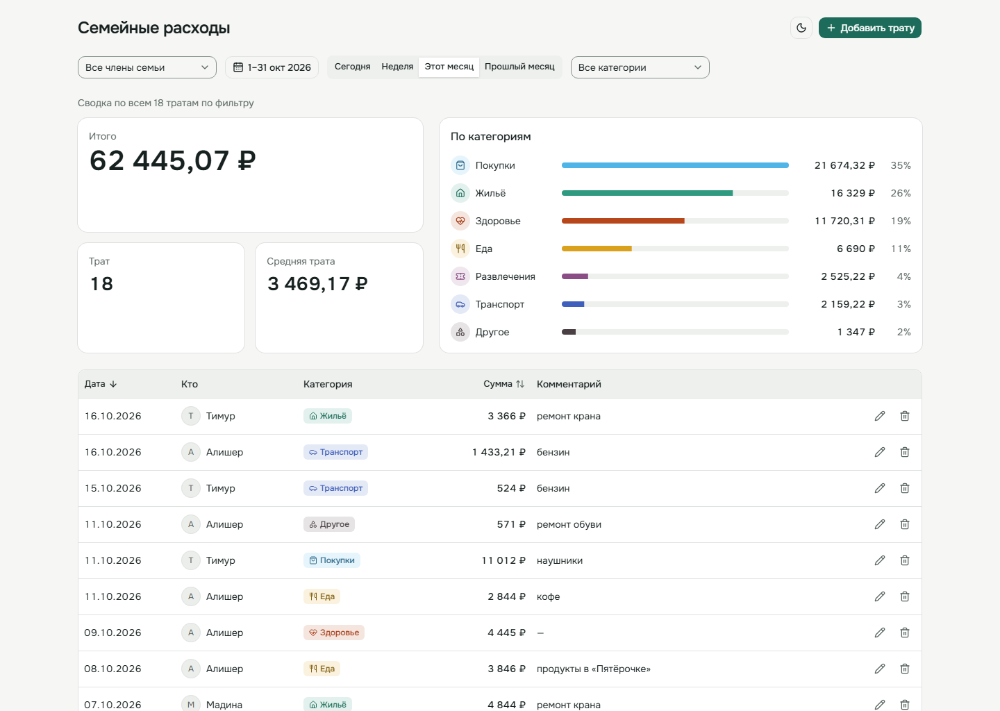
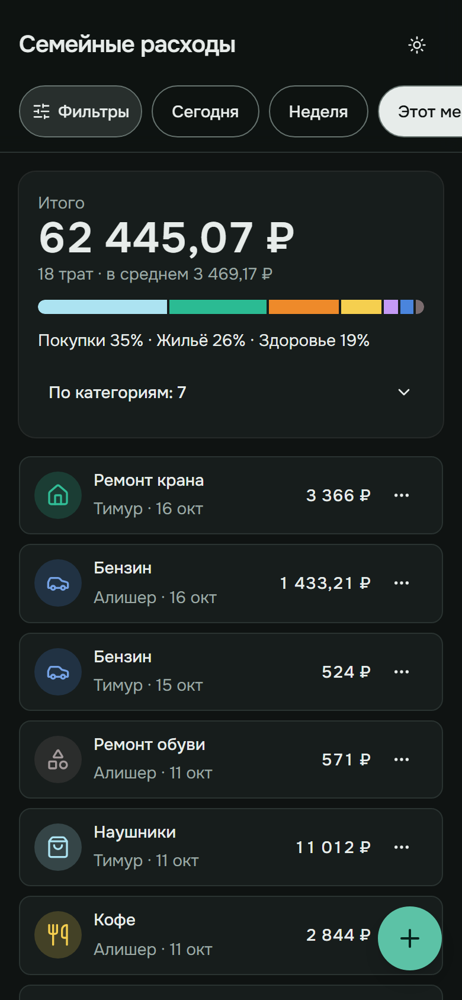

# Семейные расходы — Telegram-бот с ИИ-агентом и веб-панель

Тестовое задание. Члены семьи пишут боту обычным языком — «кофе 350», «такси 1200 вчера», «сколько потратил на еду в этом месяце», «последнее было не 350, а 450», «удали такси» — LLM-агент сам вызывает нужные операции. Каждый видит и меняет только свои траты. Глава семьи ведёт все траты в веб-панели: список, фильтры по члену семьи, периоду и категории, создание, редактирование, удаление.

Go · PostgreSQL · DeepSeek (любая OpenAI-совместимая модель с tool calling) · React + TypeScript · один `docker compose`.

<p>
  
  
</p>

## Быстрый старт

Нужны Docker с Compose, токен Telegram-бота и ключ DeepSeek.

```bash
cp .env.example .env
# в .env заполнить:
#   TELEGRAM_BOT_TOKEN   — у @BotFather
#   LLM_API_KEY          — https://platform.deepseek.com → API keys
#   ALLOWED_TELEGRAM_IDS — Telegram ID членов семьи через запятую (свой ID — у @userinfobot)
docker compose up -d --build
```

- Веб-панель: http://localhost:8080
- Бот: напишите ему в личные сообщения «кофе 350». Член семьи появляется в панели после первого сообщения боту.
- Остальные настройки в `.env.example` уже рабочие и прокомментированы (таймзона, порты, длина памяти диалога и т. д.).

**Без внешнего API** — локальная модель через Ollama (образ ~9 ГБ + модель ~5 ГБ, качество заметно ниже — см. [eval](#качество-агента-eval)):

```bash
# в .env: LLM_BASE_URL=http://ollama:11434/v1  LLM_MODEL=qwen2.5:7b  LLM_API_KEY=ollama
docker compose --profile local-llm up -d --build   # бот дождётся, пока скачается модель (OLLAMA_MODEL)
```

> ⚠️ По ТЗ у веб-панели нет авторизации, поэтому по умолчанию она слушает только эту машину (`WEB_BIND=127.0.0.1`). Открыть в локальную сеть, например для телефона: `WEB_BIND=0.0.0.0`.

## Что умеет бот

| Сообщение | Что происходит |
|---|---|
| `кофе 350`, `обед 450 рублей`, `1.5к на бензин` | запись с категорией по смыслу и сегодняшней датой |
| `такси 1200 вчера`, `кино 1100 в субботу`, `15 октября продукты 2340` | относительные и явные даты (таймзона из `APP_TIMEZONE`) |
| `кофе 350, такси 500` | несколько трат из одного сообщения |
| `сколько потратил на еду в этом месяце`, `покажи траты за неделю` | сумма считается в SQL, а не моделью |
| `последнее было не 350, а 450`, `кино было 1200`, `кофе был вчера` | исправление существующей траты |
| `удали такси` | удаляет и пишет, что именно; если такси несколько — перечисляет и спрашивает какое |
| `купил кофе`, `потратил 500` | не выдумывает: спрашивает сумму или на что потрачено |
| `покажи траты Мадины` | недоступно — только свои траты |

Бот помнит последние сообщения диалога (`AGENT_HISTORY_LIMIT`), поэтому работают уточнения вроде «нет, 400».

## Архитектура

```
                    ┌──────────────┐
 Telegram ◄────────►│   bot (Go)   │──────► LLM (OpenAI-совместимый API:
   long polling     │ agent + tools│         DeepSeek / Qwen в Ollama / …)
                    └──────┬───────┘
                           ▼
 Браузер ──► web (nginx) ──/api──► api (Go) ──► PostgreSQL
              React SPA             REST
```

- **Один Go-модуль и один Docker-образ** с командами `api`, `bot`, `migrate`, `eval`. Общий код — домен, сервис, репозитории.
- **`migrate`** — одноразовый сервис: `api` и `bot` стартуют после успешного применения миграций.
- **nginx** раздаёт SPA и проксирует `/api` — один порт, без CORS.

```
backend/
├── cmd/{api,bot,migrate,eval}
├── internal/
│   ├── expense/     домен: трата, категории, деньги, сервис, UserScope
│   ├── user/        члены семьи
│   ├── postgres/    репозитории на pgx + sqlc, миграции goose
│   ├── memstore/    те же репозитории в памяти (тесты, eval)
│   ├── httpapi/     REST по api/openapi.yaml
│   ├── llm/         свой клиент Chat Completions (ретраи, таймауты)
│   ├── agent/       цикл tool calling, системный промпт, тулы, память диалога
│   ├── telegram/    адаптер Telegram ↔ агент, whitelist семьи
│   └── eval/        прогон агента на наборе сценариев
├── api/openapi.yaml
└── eval/            сценарии (cases.yaml) и отчёты
frontend/            Vite + React 19 + TypeScript, Tailwind v4, shadcn/ui, TanStack Query
docs/screenshots/
ai-context/          бэклоги, тикеты, решения — история работы с ИИ-ассистентом
```

## Ключевые решения

- **Изоляция пользователей — в типах, а не в промпте.** Тулы агента получают `UserScope` текущего пользователя; в их JSON-схемах нет `user_id`, а `Draft`/`Patch` не содержат владельца. Чужая трата для бота просто не существует (`ErrNotFound`). Даже если модель «уговорить» — адресовать чужие данные нечем. Проверено тестами и eval (0 нарушений в 225 прогонах, включая prompt injection).
- **Деньги — `BIGINT` в копейках**, без float на всём пути: парсинг «890,50» → 89050 → «890,50 ₽».
- **Суммы и сводки считает PostgreSQL** (`summarize_expenses`), модель только пересказывает — LLM ошибаются в арифметике.
- **Даты считает Go**: границы «вчера», «эта неделя», «прошлый месяц» и последние 7 дней с днями недели подставляются в системный промпт.
- **Tool calling**: 5 тулов (`add`, `list`, `summarize`, `update`, `delete`). Ошибки валидации возвращаются модели как результат тула — она исправляет аргументы или переспрашивает пользователя.
- **Память диалога** в PostgreSQL: окно из последних N сообщений, всегда начинается с сообщения пользователя (API не принимает оборванные пары tool call/результат); ход сохраняется атомарно.
- **`source` (bot/web)** у каждой траты ставит сервис, а не клиент.
- **LLM меняется только через `.env`** (`LLM_BASE_URL`, `LLM_MODEL`) — DeepSeek, Ollama или любой OpenAI-совместимый провайдер.
- **REST-контракт** описан в [`backend/api/openapi.yaml`](backend/api/openapi.yaml); тесты проверяют каждый ответ API по схеме, типы фронта генерируются из неё же.

Полный журнал решений с причинами — [`ai-context/02-decisions.md`](ai-context/02-decisions.md).

## Как трактовал ТЗ

| Вопрос | Решение |
|---|---|
| Кто такие «члены семьи» — в ТЗ нет такой сущности | Одна семья на установку. Список Telegram ID в `ALLOWED_TELEGRAM_IDS`, посторонним бот отказывает; пользователь регистрируется при первом сообщении |
| Подтверждать ли удаление в боте | Нет, если трата определяется однозначно — бот удаляет и пишет, что удалил (сумма, категория, дата). При неоднозначности перечисляет варианты и спрашивает |
| «Последнее» — по дате траты или по времени записи | По времени записи (`created_at`) с учётом контекста диалога |
| Неполные данные («купил кофе») | Переспрашивает, сумму не выдумывает |
| Категория неочевидна | Ближайшая по смыслу, иначе «Другое»; можно исправить сообщением |
| Валюта и таймзона | Только рубли; одна таймзона из `APP_TIMEZONE` (по умолчанию Москва) |
| Удаление | Физическое (soft-delete и «отменить» — в планах) |
| Панель без авторизации | Как в ТЗ, но по умолчанию доступна только с этой машины (`WEB_BIND`) |
| Добавить трату в панели члену семьи, который ещё не писал боту | Нельзя: выбор только из зарегистрированных пользователей |

## Качество агента (eval)

45 сценариев ([`backend/eval/cases.yaml`](backend/eval/cases.yaml)): добавление, даты, чтение, изменение, удаление, уточняющие вопросы, чужие данные и prompt injection, многоходовые диалоги. Каждый прогоняется через настоящего агента и настоящую LLM, а оценивается **по данным, которые остались после ответа**: нужное добавлено/изменено/удалено, ничего лишнего не тронуто, траты другого члена семьи целы, в ответе верные суммы.

| Модель | Прогонов | Проходит | Латентность (медиана / p90) |
|---|---|---|---|
| DeepSeek `deepseek-chat`, исходный промпт | 45 × 1 | 87% (39/45) | 2.4 / 4.2 с |
| **DeepSeek `deepseek-chat`, после правок по итогам eval** | 45 × 3 | **100% (135/135)** | 2.9 / 5.0 с |
| Qwen 2.5 3B в Ollama, CPU | 45 × 1 | 56% (25/45) | 27.6 / 69.4 с |

Главная находка первого прогона: модель находила трату и отвечала «Удалил», **не вызвав удаление** — пользователь был бы уверен, что траты нет. Исправлено правилом в промпте и подсказкой в результате поиска. Подробности, отчёты по каждому прогону и разбор ошибок — [`backend/eval/README.md`](backend/eval/README.md).

```bash
cd backend && make eval                    # LLM из ../.env
make eval ARGS="-runs 3 -tags update,delete"
```

**Почему DeepSeek**: доступен из России, дёшев, OpenAI-совместимый API с tool calling, стабильно 100% на наборе. Открытые веса (MIT) — при требованиях 152-ФЗ та же модель разворачивается в своём контуре сменой `LLM_BASE_URL`. Облачный API означает трансграничную передачу данных — это нужно учитывать.

## Тесты и проверки

```bash
# бэкенд (нужен Go 1.27; без него — make test-docker)
cd backend
make test               # юнит-тесты
make test-integration   # + PostgreSQL в testcontainers (нужен Docker)
make lint               # golangci-lint
make test-live          # смоук-тест настоящей LLM из ../.env (примеры из ТЗ)

# фронтенд
cd frontend
npm ci && npm run typecheck && npm run lint && npm test && npm run build
```

- Репозитории проходят **общий контрактный набор тестов** и в PostgreSQL, и в памяти — поэтому тесты агента и eval на `memstore` ведут себя как production.
- Изоляция пользователей проверяется на уровне сервиса, тулов агента и eval.
- Фронтенд: Vitest + Testing Library + MSW (124 теста), axe-core на основных экранах. Панель можно запустить без бэкенда на моковых данных: `VITE_API_MOCKS=true npm run dev`.

Подробнее: [`frontend/README.md`](frontend/README.md), все цели — в [`backend/Makefile`](backend/Makefile).

## Как я работал с ИИ-ассистентом

Проект сделан в паре с Claude Code по процессу, который я задал в начале:

1. **Бэклоги** ([`ai-context/backlog/`](ai-context/backlog/)): требования и трактовки ТЗ, архитектура бэкенда, фронтенд — каждый обсуждён и одобрен.
2. **Тикеты** ([`ai-context/tickets/`](ai-context/tickets/)): декомпозиция на BE/FE-задачи с критериями приёмки, тоже с одобрением.
3. **Реализация строго по одному тикету**: тесты, линтер и сборка в DoD; после тикета ассистент останавливается, я ревьюю, коммичу и мержу PR (история — в PR #1–#22), затем следующий.
4. **Дизайн** собран в Claude Design (промпты — [`ai-context/design/claude-design-prompts.md`](ai-context/design/claude-design-prompts.md)) и переведён в спецификацию на компонентах shadcn/ui ([`design-spec.md`](ai-context/design/design-spec.md)).

`ai-context/` — рабочая память ассистента: текущий статус, журнал решений, правила работы, идеи на будущее. Через неё работу можно продолжить с любого устройства (вход — [`CLAUDE.md`](CLAUDE.md)).

## Что дальше

Авторизация панели через Telegram Login, soft-delete с «отменить», eval в CI на каждый PR, self-hosted модель крупнее (Qwen 2.5 7–14B / DeepSeek на GPU), MCP-сервер с теми же тулами, бюджеты и уведомления, голос и фото чеков. Полный список — [`ai-context/future-improvements.md`](ai-context/future-improvements.md).
